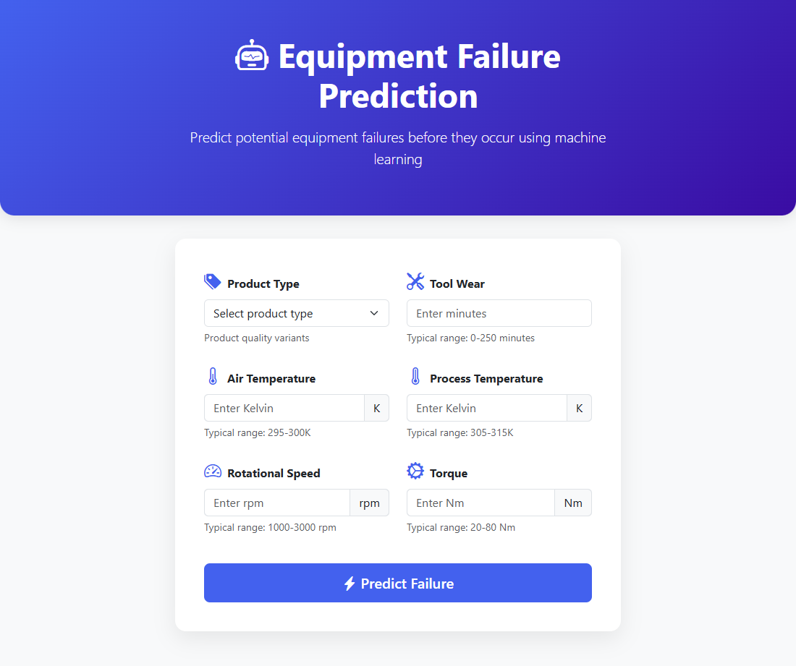
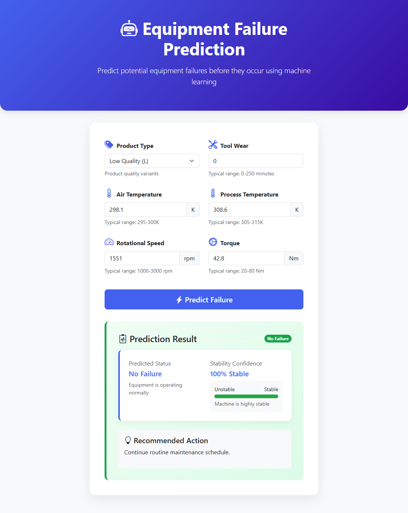
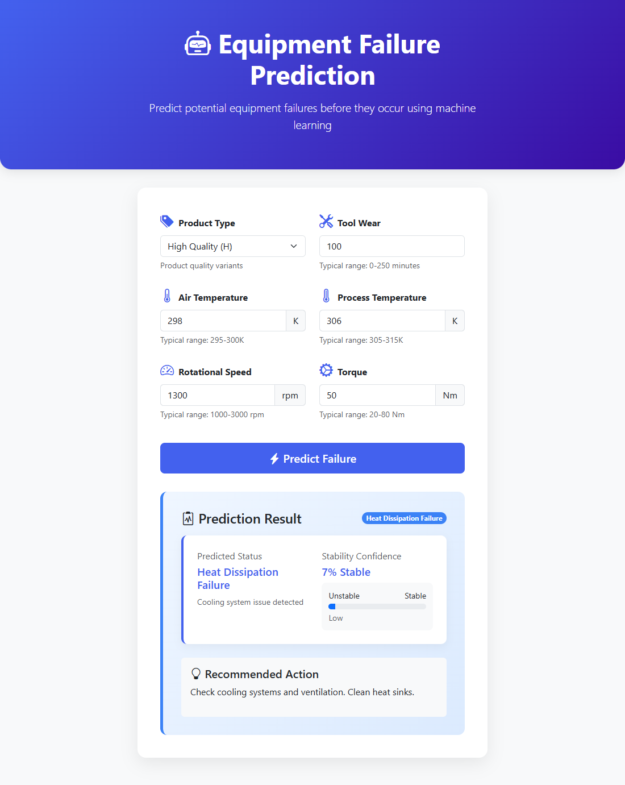
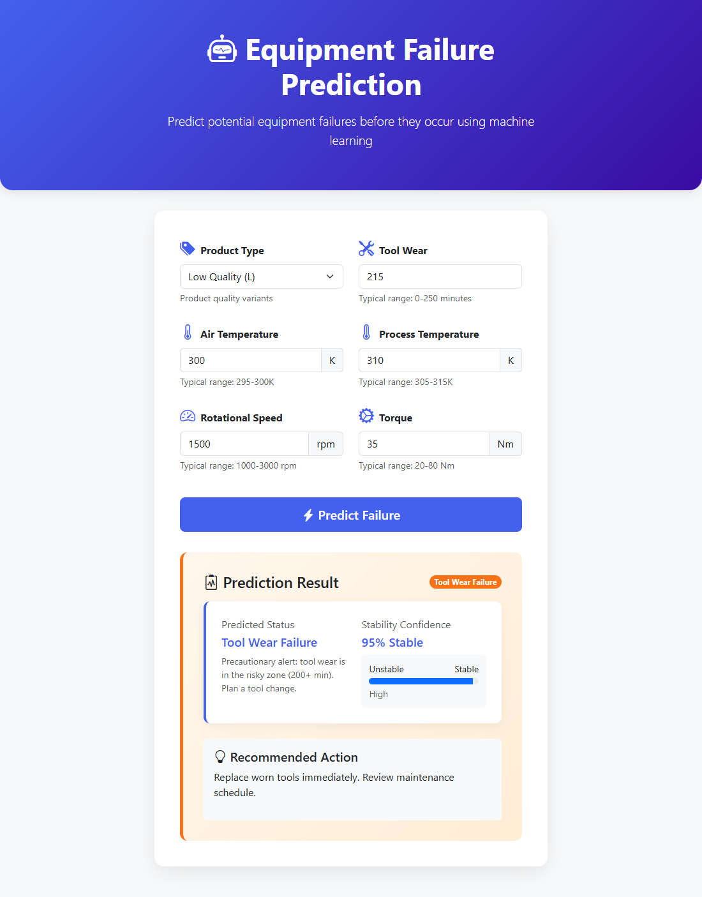

# Equipment Failure Prediction System

Flask web app that predicts the type of machine failure (or "No Failure") from sensor readings
of the AI4I 2020 Predictive Maintenance dataset (10,000 rows).



## What changed in this update and why

**Problem:** the original Random Forest failed on the rare failure classes. "No Failure" is 96.5% of the
data, while Tool Wear has 45 rows, Random Failures 18, Overstrain 78, Power 95 and Heat Dissipation 112.
Accuracy looked great (96%) but the model missed many real failures.

| Change | Why |
|---|---|
| Resampling comparison (`train_balanced.py`): random oversampling, SMOTE, undersampling, SMOTE+undersampling, noise-based data augmentation | Give the rare classes more weight during training. Resampling is applied to the **train split only**, the test split stays untouched so the metrics are honest. Results in `resampling_results.csv`. |
| Feature engineering (`features.py`): power in watts, wear x torque, overstrain margin per product type, heat-dissipation condition, temperature-difference x rpm, etc. | The failure modes follow physical rules (e.g. overstrain = wear x torque above a per-type limit). Giving the model those quantities directly is what fixed Heat Dissipation, Overstrain and Power. |
| Ensemble of RandomForest + ExtraTrees + HistGradientBoosting, oversampling, per-class probability weights tuned on cross-validation out-of-fold predictions (`train_v2.py`, `train_final.py`) | More stable on tiny classes; weights tuned without touching the test set. |
| Tool Wear alert rule: if the model says "No Failure" but tool wear >= 198 min, flag Tool Wear | Tool Wear is not separable from normal operation by sensor values alone (only ~5.5% of rows with wear >= 198 are failures). The rule trades precision for recall (see below). |
| `app.py` now loads `model_final.pkl` and uses the same feature code as training | The old app only sent 8 features and used the old model. |
| Random Failures removed from training/evaluation | See "Honest limitations". |

### Results (20% held-out test split, 5 learnable classes)

| Class | F1 before (oversampling only) | F1 now |
|---|---|---|
| Heat Dissipation | 0.96 | 1.00 |
| Power Failure | 1.00 | 1.00 |
| Overstrain | 0.73 | 0.97 |
| No Failure | 0.98 | 0.99 |
| Tool Wear | 0.10 | 0.11 (model only) / 0.09 with alert |

| | macro-F1 | accuracy | Tool Wear recall |
|---|---|---|---|
| Original model, 6 classes | 0.61 | 0.958 | 0.33 |
| New model, 5 classes, model only | **0.81** | 0.984 | 0.22 |
| New model, 5 classes, + Tool Wear alert (used by the app) | **0.80** | 0.921 | 0.89 |

The alert catches 8 of 9 Tool Wear failures but raises about 157 false alarms in the test set,
so macro-F1 stays about the same while recall rises. Remove the rule (`WEAR_ALERT`) if false alarms matter more than missed failures.

### Honest limitations

- **Random Failures** (18 rows) are random by construction in this dataset: all have `Target = 0` and ordinary sensor
  values. No model can predict them, so they are excluded and the 0.80 macro-F1 is on **5 classes**.
  On all 6 classes the best result is about 0.66.
- **Tool Wear** has only 9 test samples, so its metrics move by a few points if the split changes.
- The UCI original of the dataset was checked: it is the exact same 10,000 rows, so merging adds no data.

### Screenshots

| No Failure | Heat Dissipation | Tool Wear alert |
|---|---|---|
|  |  |  |

## Setup

```bash
python -m venv venv
venv\Scripts\activate        # Linux/Mac: source venv/bin/activate
pip install -r requirements.txt
python app.py
```

Open `http://localhost:5000`. The trained model (`equipment_failure_Prediction/model_final.pkl`) is included.

## Retrain

```bash
python train_balanced.py   # compare resampling strategies -> resampling_results.csv
python train_final.py      # train + evaluate + save model_final.pkl
```

`train_v2.py` holds the shared training helpers (models, oversampling, class-weight tuning).

## Input parameters

- Product type (L / M / H)
- Air temperature (K), Process temperature (K)
- Rotational speed (rpm), Torque (Nm)
- Tool wear (min)

## License

MIT License
